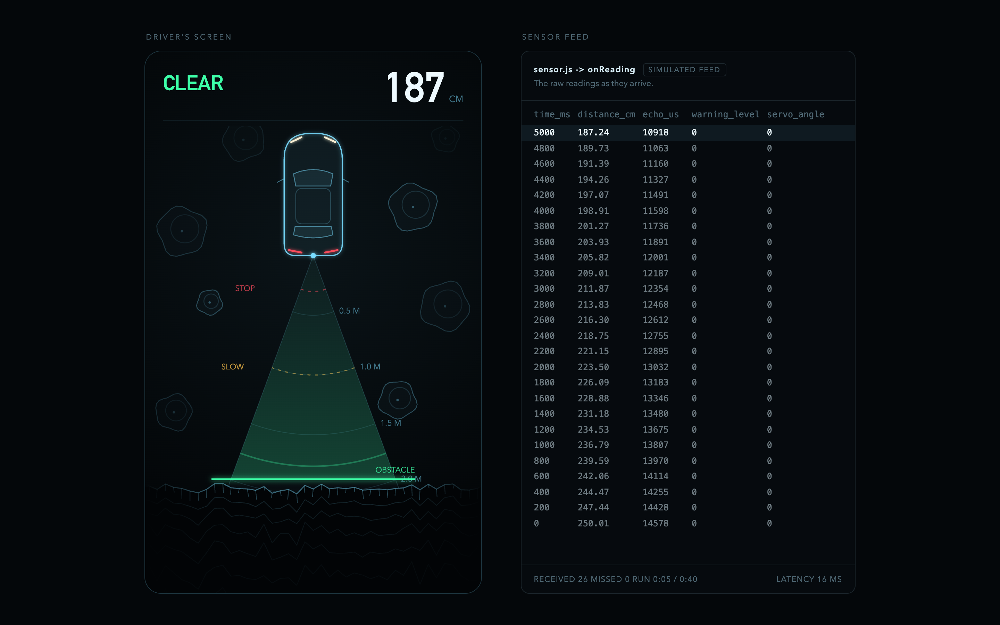
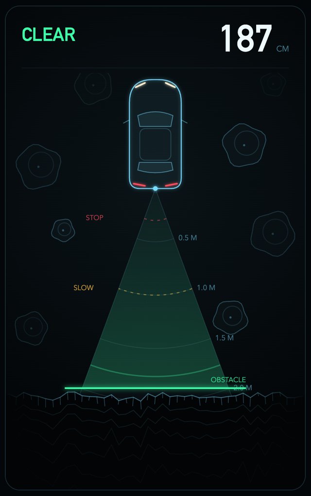
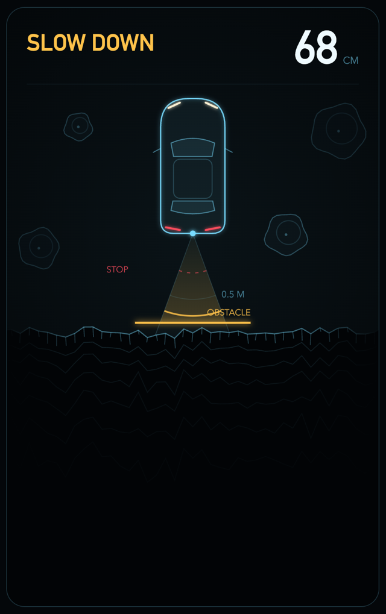
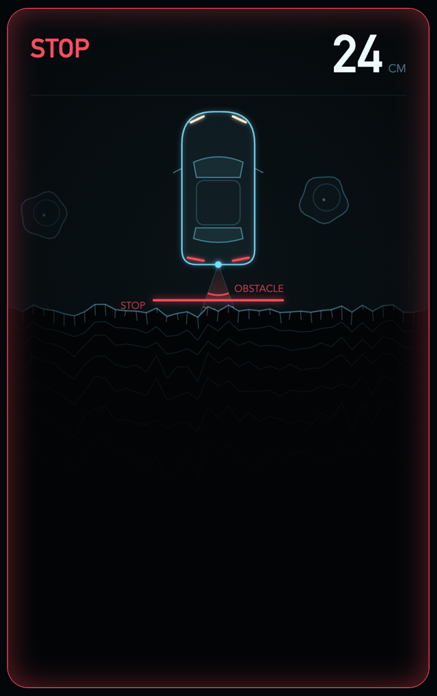
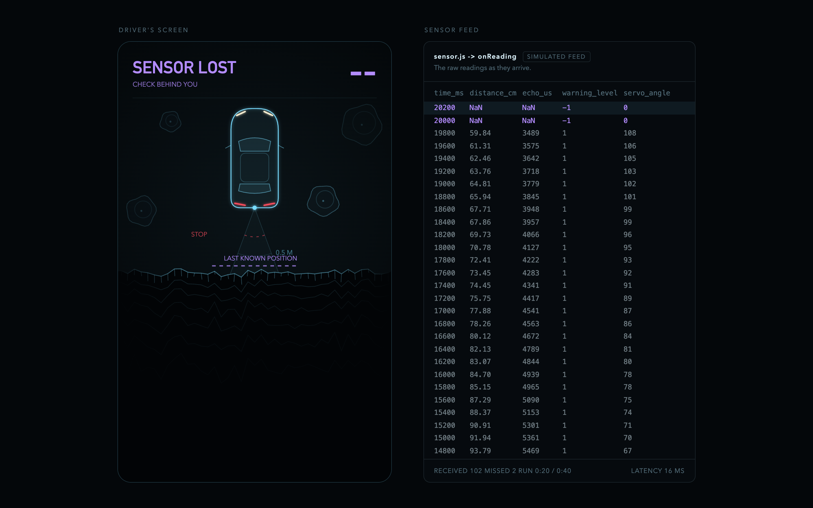
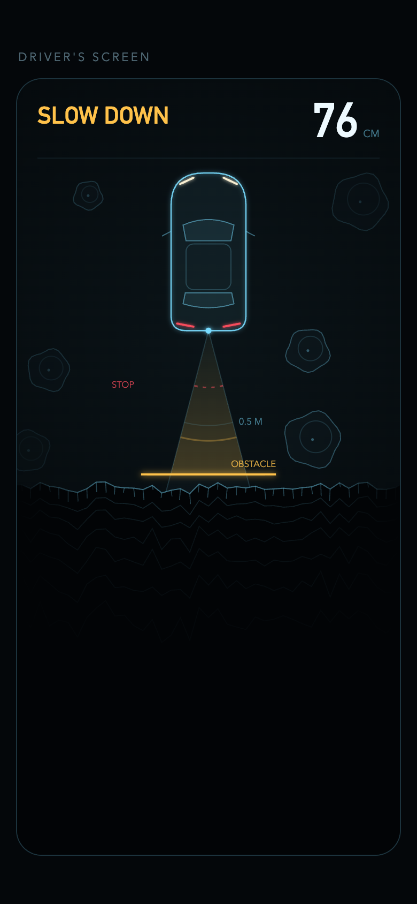

# Rear parking screen demo

Try it here: **https://larryworkshopdemo.vercel.app**

This is a demo we built for an AI workshop in ENAS 1180, Larry Wilen's first-year engineering class at Yale, in November 2026. Felix ran the software half and Gusty ran the hardware half.

It's a parking screen for the back of a car. A recorded reversing run plays through a simulated rear sensor, and the screen shows how close the car is to the obstacle behind it, with beeps that speed up as it gets closer. It's a teaching demo, so it isn't meant as a finished product.



## Why we built it

The workshop was about using AI as a companion through the whole engineering process. The catch is that AI gives you back roughly what you put in. A vague ask gets you a vague build, and a clear plan gets you something close to what you actually wanted.

So in the software half, students act as the architect. They start from a given goal, write their own requirements, and only then hand the build to an AI coding agent like Codex or Claude Code. This demo is us doing that same exercise ourselves first. We wrote the goal, the requirements and the design choices, then built it from them. Students get to see what the end of the process looks like before they try it.

It also connects the two halves of the class. In the hardware half, students wire up an ultrasonic sensor on an Arduino in the Wokwi simulator, and it prints one reading every 200 ms. The data here is in that same format, so the readings the hardware part prints are the readings this screen runs on.

## The goal we built from

> Build a parking screen that a car manufacturer could put on their infotainment screen. It should be intuitive enough that a driver who glances at it while parking knows how close they are to the obstacle. It runs on distance readings from the car's rear parking sensor.

The sensor is on the rear because the driver can already see what's in front of them.

## What it does

The car is drawn from above, with the obstacle behind it to scale and range rings every 50 cm. The gap is coloured by zone, and the beeping speeds up as the car gets closer. Each beep also sends out a radar pulse, so the picture and the sound always agree.

| Clear, 100 cm and up | Slow down, 30 to 100 cm | Stop, under 30 cm |
|---|---|---|
|  |  |  |
| 1 beep a second | 2 beeps a second | 4 beeps a second, and the border glows red |

About 20 seconds in, the sensor goes blind for a moment and the feed starts sending `NaN`. The screen switches to SENSOR LOST, marks where the obstacle was last seen and plays a different sound. If the beeping just stopped, the silence would sound safe.



The screen keeps up in real time. It reacts within 100 ms of each reading, and the feed panel shows the latency so you can check.



On a phone you get just the driver's screen at full width, so Larry and the students could open it on their own devices.

Press Start to turn on the sound, since browsers block audio until you click something. The run lasts about 40 seconds and then offers a replay.

<br clear="right">


## How it's put together

It's plain HTML, CSS and JavaScript. There's nothing to install and no build step, so it runs from Vercel or from a double-clicked `index.html`.

| File | What it does |
|---|---|
| `index.html` | The parking screen itself, drawn on a canvas. |
| `sensor.js` | Pretends to be the car's rear sensor. It replays the recorded run at its real pace and hands each reading to the screen through `sensor.onReading`. |
| `data.js` | The recorded 40-second reversing run, as CSV text. |
| `sounds/` | The beep and the sensor-lost sound. |

Each reading looks like this, the same columns the Arduino sketch prints:

```text
time_ms,distance_cm,echo_us,warning_level,servo_angle
```

A missed reading comes through with `NaN` for the distance.

Because the screen only talks to `sensor.onReading`, the same screen could run off a real Arduino later, as long as something feeds that hook with live readings.

## Run it locally

Double-click `index.html`. If you'd rather serve it, run this from the folder and open http://localhost:8000:

```bash
python3 -m http.server 8000
```

Sound is a little more reliable when it's served, because the page can then play the sounds through the Web Audio API.
